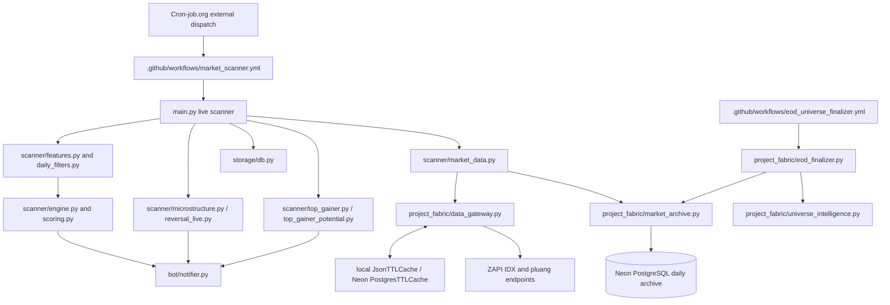

# Bot 4 source map — initial manual inventory

**Provenance:** inspected directly from `main` on 2026-10-14, before the optional Graphify analysis. This is a developer-maintained starting map, **not** generated graph data and not a runtime trace.

## Operating boundaries

Arrows represent **module/data relationships visible in source**, not a guarantee that every branch executes in each scanner cycle. Graphify can extend and validate the call graph after installation in a local clone.

## Files to inspect first

| Change requested | Start with | Regression concern |
| --- | --- | --- |
| Market freshness / reduced ZAPI usage | `scanner/market_data.py`, `project_fabric/data_gateway.py`, `project_fabric/postgres_backend.py` | Preserve cache policy, fallback, and API usage metering |
| EOD date stale or missing | `project_fabric/eod_finalizer.py`, `project_fabric/market_archive.py`, `project_fabric/universe_intelligence.py` | Never use an intraday partial candle as final EOD |
| Alert phases / deduplication | `scanner/engine.py`, `scanner/scoring.py`, `storage/db.py` | Preserve ignition -> pre-momentum -> powerful momentum state rules |
| Reversal and pullback | `scanner/reversal_live.py`, `scanner/entry_setup.py`, `scanner/eod_plan_live.py` | Separate live confirmation from historical EOD plan |
| Top Gainer / potential | `scanner/top_gainer.py`, `scanner/top_gainer_potential.py`, `bot/notifier.py` | Existing market payload only; private output should not become group spam |
| Telemetry / costs | `project_fabric/data_gateway.py`, `project_fabric/observability.py` | Do not increase upstream calls or add periodic hosted analysis |

## Verified configuration relevant to the rollout

- `market_scanner.yml`: 4-minute job timeout, current `FILTER2_ENABLED=false`, `PTSN_STRUCTURE_ENABLED=false`.
- `market_scanner.yml`: `TOP_GAINER_TARGET=private`, `TOP_GAINER_ENABLED=true`, and `TOP_GAINER_POTENTIAL_ENABLED=true`.
- `market_scanner.yml`: `SHAREHOLDER_FILTER_ENABLED=false` (do not silently turn it on).
- `project_fabric/data_gateway.py`: policy for latest IDX stock-summary is 300-second TTL and up to 900-second stale-on-error fallback; historical dated summary uses a longer policy. Live quotes, orderbook, and running trades must not inherit historical TTL by accident.
- `project_fabric/eod_finalizer.py`: completed-session candle merge prefers dated EOD stock summary, and is intended to use cached history for finalization.
- `project_fabric/market_archive.py`: archives per ticker and date, guards against premature completed-EOD writes.
- `.github/workflows/project_fabric_ci.yml`: separate pull-request CI using PostgreSQL 16 test service; not part of the scanner's 4-minute live budget.

## Acceptance checks before any refactor

1. Compare outputs from identical snapshot fixtures before and after the code change.
2. Assert no additional `DataGateway` upstream calls for a pure refactor.
3. Assert stale EOD does not masquerade as a current completed session.
4. Assert Top Gainer and Top Gainer Potential retain the Telegram personal-chat routing.
5. Assert stage ordering, alert cooldown, and suppression of duplicate alerts remain consistent.
6. Keep changes on a separate branch. Merge only after test evidence and review.

## Next Graphify run

From the local repository root, install Graphify per `AI_SKILLS_SETUP.md`, invoke `/graphify .` in a supported coding assistant, and inspect `graphify-out/graph.html` and `GRAPH_REPORT.md`. Keep generated output untracked. Confirm nodes and dependency edges against this map; only then choose a constrained source-code refactor.
